# RustAdmin WebRCON — Visual Tour & Screenshots

A visual walkthrough of the 12 core interfaces and tools in **RustAdmin WebRCON**.

---

## Table of Contents
1. [Server Overview & Dashboard](#1-server-overview--dashboard)
2. [Server Rules & Convars Manager](#2-server-rules--convars-manager)
3. [Automation, Graceful Restarts & Wipe Wizard](#3-automation-graceful-restarts--wipe-wizard)
4. [Live Console with Autocomplete & Multi-Level History](#4-live-console-with-autocomplete--multi-level-history)
5. [Interactive Live Map & Radar](#5-interactive-live-map--radar)
6. [Live Combat, Raid & Anti-Cheat Feed](#6-live-combat-raid--anti-cheat-feed)
7. [In-Game Global Chat & Broadcaster](#7-in-game-global-chat--broadcaster)
8. [Player Directory & Moderation](#8-player-directory--moderation)
9. [Oxide Plugins & Integrated Permissions Matrix](#9-oxide-plugins--integrated-permissions-matrix)
10. [Ultra-Fast Item Browser (1,317 Items & DLC Badges)](#10-ultra-fast-item-browser-1317-items--dlc-badges)
11. [Kits & Custom Loadout Spawner](#11-kits--custom-loadout-spawner)
12. [Vehicle & World Prefab Spawner](#12-vehicle--world-prefab-spawner)

---

### 1. Server Overview & Dashboard
Real-time server metrics, procedural map info card (seed, world size, protocol version), environmental time/weather controls, and instant world event triggers (Bradley APC, Patrol Heli, Cargo Ship, Supply Drop).

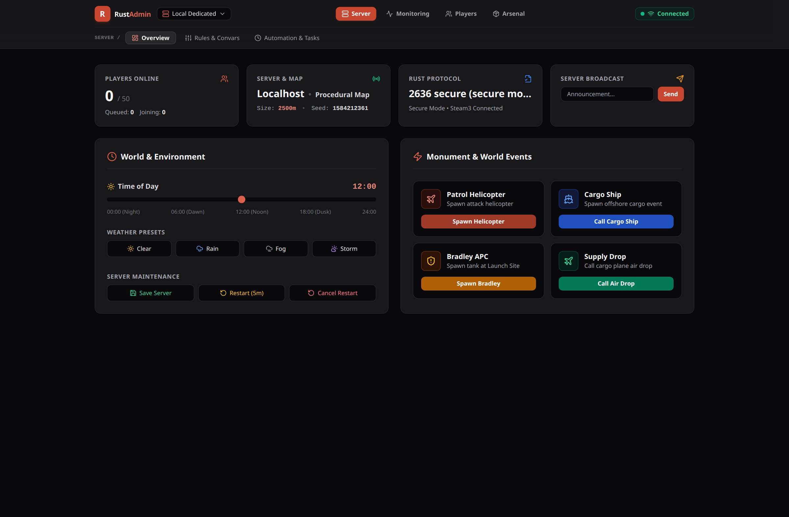

---

### 2. Server Rules & Convars Manager
Interactive sliders and toggles for building decay (`decay.scale`), upkeep, structural stability, radiation, day/night cycle lengths (`env.daylength`, `env.nightlength`), team size limits, PvE mode, and 1-click ruleset presets (*Vanilla*, *Creative Sandbox*, *Solo Hardcore*).

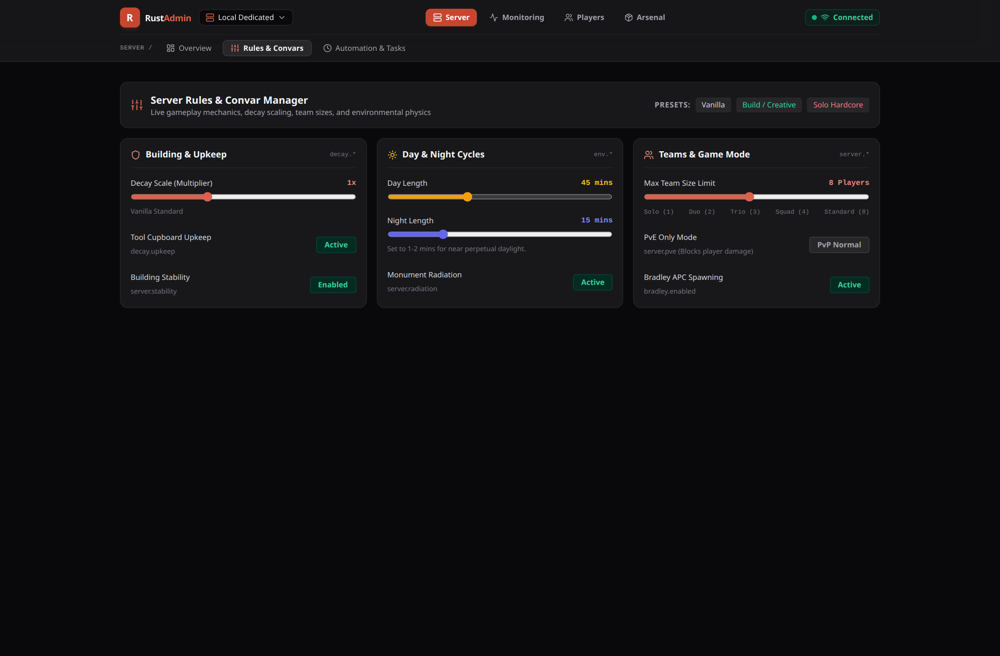

---

### 3. Automation, Graceful Restarts & Wipe Wizard
Scheduled multi-milestone restarts (10m, 5m, 1m, 10s warnings with automatic world save and 1-click abort), background recurring chat announcer, and wipe day seed/worldsize configurator.

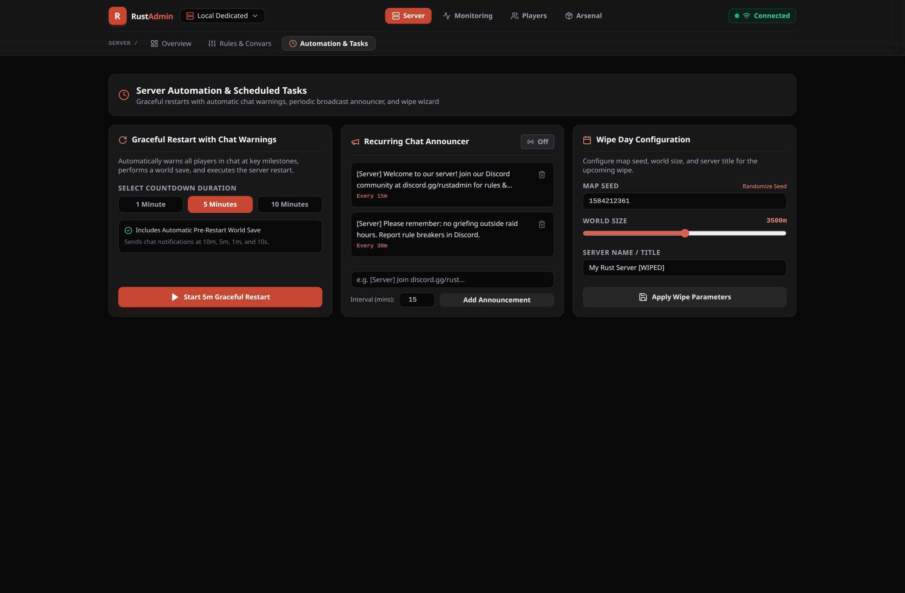

---

### 4. Live Console with Autocomplete & Multi-Level History
Live streaming RCON console with multi-level command history (<kbd>↑</kbd> and <kbd>↓</kbd> arrows through 100 entries), <kbd>Tab</kbd> completion, and dynamic active argument helper chips with clickable connected player SteamIDs.

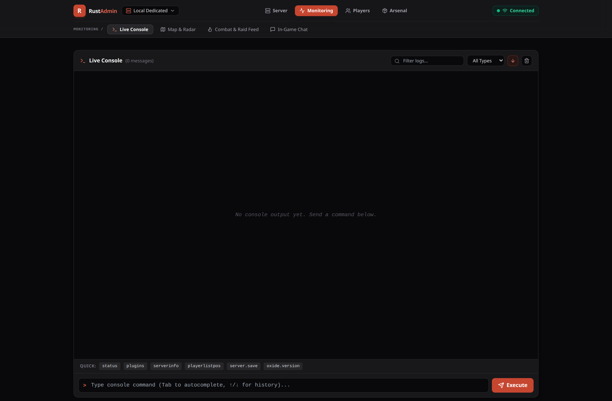

---

### 5. Interactive Live Map & Radar
Custom high-resolution procedural map with monument POIs, live online player tracking dots, grid coordinates, admin click-to-teleport, and instant minicopter spawning at coordinates.

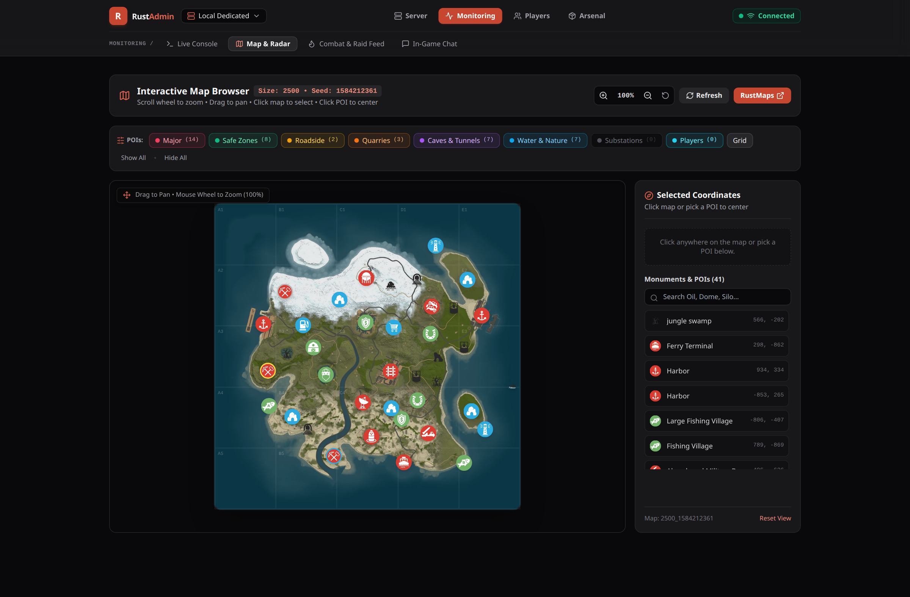

---

### 6. Live Combat, Raid & Anti-Cheat Feed
Real-time console stream parser categorizing PvP kills, explosive detonations (Timed C4, Rockets, MLRS), and anti-cheat infractions (`flyhack: violation`, `speedhack`) with instant **Kick** and **Ban** moderation buttons.

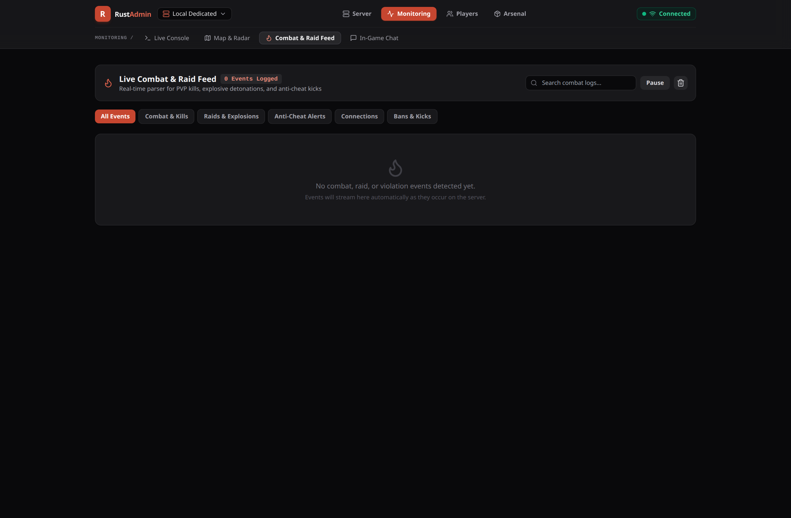

---

### 7. In-Game Global Chat & Broadcaster
Real-time server chat monitor with sender coloring, timestamping, and server announcement broadcaster (`say <message>`).

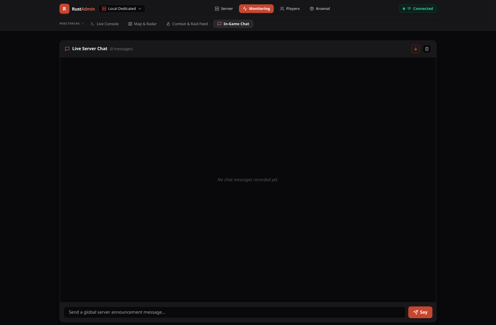

---

### 8. Player Directory & Moderation
Searchable player roster displaying SteamID, ping badge, connection duration, IP address, and instant action modals for Kick, Ban, Mute, and Teleport.

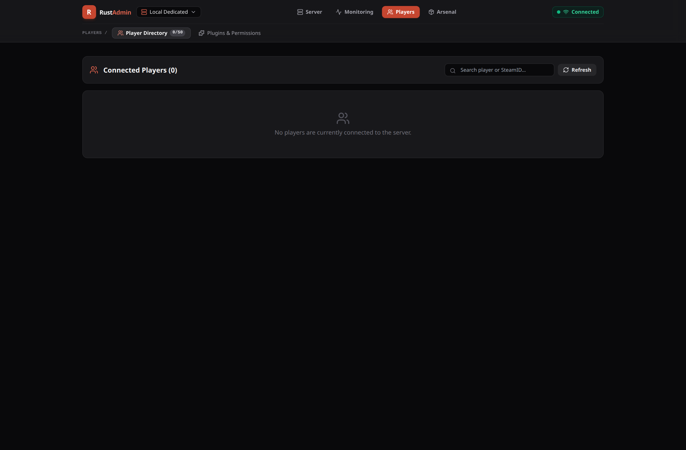

---

### 9. Oxide Plugins & Integrated Permissions Matrix
Complete Oxide/uMod plugin manager with loaded/unloaded/error statuses and memory metrics. Each plugin features a twisty expanding accordion revealing its permissions grid with 1-click group grant/revoke toggles and batch actions.

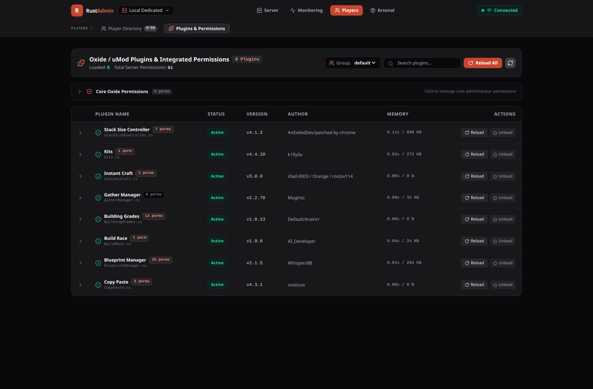

---

### 10. Ultra-Fast Item Browser (1,317 Items & DLC Badges)
All 1,317 official game items powered by a single 2.57 MB WebP sprite sheet. Includes 16 categories, instant search, stack size badges, distinct **`DLC`** tags across 197+ pack items, and a direct Give modal with admin spawning reassurance.

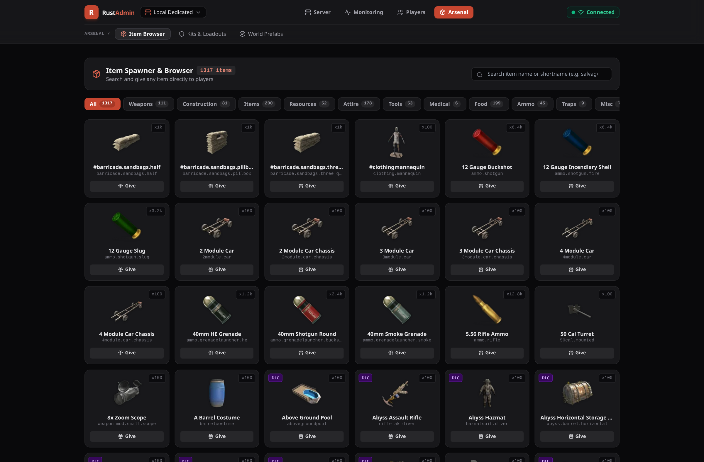

---

### 11. Kits & Custom Loadout Spawner
Endgame gear presets (*Full Metal AK-47*, *Roadsign SAR*, *Heavy Raid Breacher*, *Base Builder*, *Electrician Toolkit*, *Emergency Medic*) and an interactive visual custom kit creator with 1-click batch delivery.

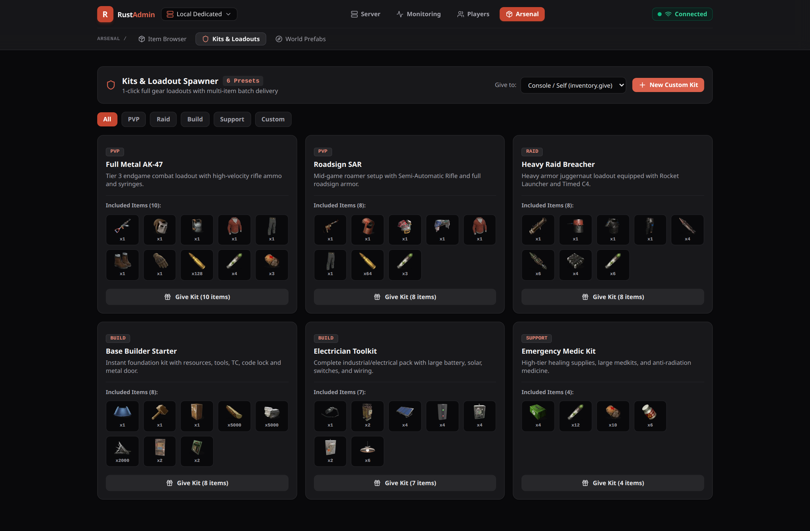

---

### 12. Vehicle & World Prefab Spawner
1-Click physical world entity and vehicle instantiation for air, land, sea, deployed workbenches/research tables, and event triggers, with optional target coordinate injection.

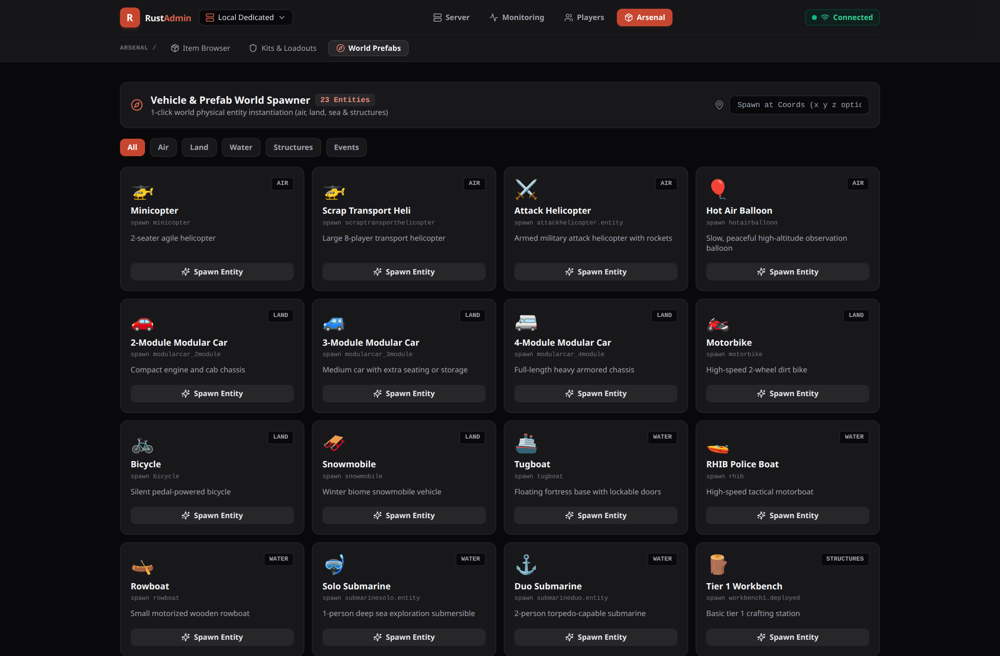
